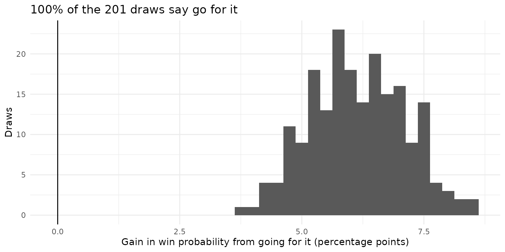

# Get Started with nfl4th

First load the packages and some data.
[`load_4th_pbp()`](https://www.nfl4th.com/reference/load_4th_pbp.md)
loads `nflfastR` data and computes 4th down probabilities (depending on
your computer, this may take up to a minute or two per season).

``` r

library(nfl4th)
library(tidyverse)
library(gt)

data <- nfl4th::load_4th_pbp(2020)
```

## Easy mode: using nflfastR data

Here’s what the data obtained using
[`load_4th_pbp()`](https://www.nfl4th.com/reference/load_4th_pbp.md)
looks like:

``` r

data |>
  dplyr::filter(!is.na(go_boost)) |>
  utils::head(10) |>
  dplyr::select(
    posteam, ydstogo, yardline_100, posteam, go_boost, first_down_prob, 
    wp_fail, wp_succeed, go_wp, fg_make_prob, miss_fg_wp, make_fg_wp, 
    fg_wp, punt_wp
  ) |>
  knitr::kable(digits = 2)
```

| posteam | ydstogo | yardline_100 | go_boost | first_down_prob | wp_fail | wp_succeed | go_wp | fg_make_prob | miss_fg_wp | make_fg_wp | fg_wp | punt_wp |
|:---|---:|---:|---:|---:|---:|---:|---:|---:|---:|---:|---:|---:|
| SF | 3 | 34 | 1.30 | 0.60 | 0.68 | 0.78 | 0.74 | 0.64 | 0.67 | 0.76 | 0.73 | 0.71 |
| ARI | 10 | 65 | -1.24 | 0.29 | 0.18 | 0.28 | 0.21 | 0.00 | 0.17 | 0.29 | 0.17 | 0.22 |
| ARI | 7 | 72 | 0.45 | 0.45 | 0.08 | 0.15 | 0.11 | 0.00 | 0.08 | 0.14 | 0.08 | 0.11 |
| SF | 5 | 64 | 0.17 | 0.51 | 0.84 | 0.91 | 0.87 | 0.00 | 0.83 | 0.91 | 0.83 | 0.87 |
| SF | 3 | 68 | 0.61 | 0.61 | 0.70 | 0.79 | 0.76 | 0.00 | 0.69 | 0.80 | 0.69 | 0.75 |
| ARI | 9 | 77 | -1.45 | 0.31 | 0.17 | 0.27 | 0.20 | 0.00 | 0.16 | 0.29 | 0.16 | 0.22 |
| SF | 1 | 1 | 3.30 | 0.64 | 0.76 | 0.87 | 0.83 | 0.99 | 0.75 | 0.80 | 0.80 | NA |
| ARI | 5 | 34 | 0.70 | 0.46 | 0.22 | 0.35 | 0.28 | 0.64 | 0.22 | 0.31 | 0.27 | 0.25 |
| SF | 9 | 36 | -0.29 | 0.33 | 0.71 | 0.83 | 0.75 | 0.57 | 0.70 | 0.79 | 0.75 | 0.74 |
| SF | 2 | 6 | 1.31 | 0.60 | 0.75 | 0.87 | 0.83 | 0.98 | 0.75 | 0.81 | 0.81 | NA |

Or we can add some filters to look up a certain game:

``` r

data |>
  dplyr::filter(week == 20, posteam == "GB", down == 4) |>
  dplyr::select(
    posteam, ydstogo, yardline_100, posteam, go_boost, first_down_prob, 
    wp_fail, wp_succeed, go_wp, fg_make_prob, miss_fg_wp, make_fg_wp, 
    fg_wp, punt_wp
  ) |>
  knitr::kable(digits = 2)
```

| posteam | ydstogo | yardline_100 | go_boost | first_down_prob | wp_fail | wp_succeed | go_wp | fg_make_prob | miss_fg_wp | make_fg_wp | fg_wp | punt_wp |
|:---|---:|---:|---:|---:|---:|---:|---:|---:|---:|---:|---:|---:|
| GB | 17 | 65 | -3.07 | 0.14 | 0.33 | 0.47 | 0.35 | 0.00 | 0.31 | 0.46 | 0.31 | 0.38 |
| GB | 6 | 6 | 1.46 | 0.36 | 0.34 | 0.55 | 0.42 | 0.98 | 0.33 | 0.40 | 0.40 | NA |
| GB | 15 | 86 | -4.79 | 0.16 | 0.15 | 0.35 | 0.18 | 0.00 | 0.13 | 0.37 | 0.13 | 0.23 |
| GB | 10 | 76 | 0.49 | 0.40 | 0.14 | 0.35 | 0.22 | 0.00 | 0.13 | 0.34 | 0.13 | 0.22 |
| GB | 8 | 8 | 6.08 | 0.37 | 0.02 | 0.31 | 0.13 | 0.98 | 0.01 | 0.07 | 0.07 | NA |

We see the infamous field goal at the bottom.

## Calculations from user input

The below shows the bare minimum amount of information that has to be
fed to `nfl4th` in order to compute 4th down decision recommendations.
The main function on user-input data is
[`add_4th_probs()`](https://www.nfl4th.com/reference/add_4th_probs.md).

The reason teams from a specific game have to be used is that the model
depends on factors such as point spread, team totals, and indoor/outdoor
and the program automatically looks these up so that users don’t have to
provide them.

``` r

one_play <- tibble::tibble(
  
  # things to help find the right game (use "reg" or "post" for type)
  home_team = "GB",
  away_team = "TB",
  posteam = "GB",
  type = "post",
  season = 2020,
  
  # information about the situation
  qtr = 4,
  quarter_seconds_remaining = 129,
  ydstogo = 8,
  yardline_100 = 8,
  score_differential = -8,

  home_opening_kickoff = 0,
  posteam_timeouts_remaining = 3,
  defteam_timeouts_remaining = 3
)

one_play |>
  nfl4th::add_4th_probs() |>
  dplyr::select(
    posteam, ydstogo, yardline_100, posteam, go_boost, first_down_prob, 
    wp_fail, wp_succeed, go_wp, fg_make_prob, miss_fg_wp, make_fg_wp, 
    fg_wp, punt_wp
  ) |>
  knitr::kable(digits = 2)
#> ℹ Computing probabilities for 1 plays. . .
```

| posteam | ydstogo | yardline_100 | go_boost | first_down_prob | wp_fail | wp_succeed | go_wp | fg_make_prob | miss_fg_wp | make_fg_wp | fg_wp | punt_wp |
|:---|---:|---:|---:|---:|---:|---:|---:|---:|---:|---:|---:|---:|
| GB | 8 | 8 | 6.08 | 0.37 | 0.02 | 0.31 | 0.13 | 0.98 | 0.01 | 0.07 | 0.07 | NA |

Comparing this and the table above, we see the exact same numbers as
expected.

## Make a summary table

Let’s put the play above into a table using the provided function
[`make_table_data()`](https://www.nfl4th.com/reference/make_table_data.md),
which makes it easier to interpret the recommendations for a play. This
function only works with one play at a time since it makes a table using
the results from the play.

``` r

one_play |>
  nfl4th::add_4th_probs() |>
  nfl4th::make_table_data() |>
  knitr::kable(digits = 1)
#> ℹ Computing probabilities for 1 plays. . .
```

| choice             | choice_prob | success_prob | fail_wp | success_wp |
|:-------------------|------------:|-------------:|--------:|-----------:|
| Go for it          |        12.7 |         36.5 |     2.1 |       31.1 |
| Field goal attempt |         6.6 |         97.6 |     1.5 |        6.8 |
| Punt               |          NA |           NA |      NA |         NA |

Looking at the table, the Packers would be expected to have 12.7% win
probability if they had gone for it and 8.9% if they kicked a field
goal. This difference of 3.8 percentage points is [almost exactly the
same as PFF’s 3.5 percentage
points](https://twitter.com/benbbaldwin/status/1354239287299088384) for
the decision.

## Make a summary table for a 2-point decision

`nfl4th` also contains a function to calculate 2-point decisions. Let’s
put in the situation that would have happened if the Packers had scored
a touchdown on the 4th & 8. We don’t need a calculator to know that they
should have gone for two, but let’s practice by putting in the numbers,
assuming that the 4th down play took 6 seconds while resulting in a
touchdown.

``` r

another_play <- tibble::tibble(
  
  # things to help find the right game (use "reg" or "post")
  home_team = "GB",
  away_team = "TB",
  posteam = "GB",
  type = "post",
  season = 2020,
  
  # information about the situation
  qtr = 4,
  quarter_seconds_remaining = 123,
  score_differential = -2,

  home_opening_kickoff = 0,
  posteam_timeouts_remaining = 3,
  defteam_timeouts_remaining = 3
)

another_play |>
  nfl4th::add_2pt_probs() |>
  nfl4th::make_2pt_table_data() |>
  knitr::kable(digits = 1)
#> ℹ Computing probabilities for  1 plays. . .
```

| choice   | choice_prob | success_prob | fail_wp | success_wp |
|:---------|------------:|-------------:|--------:|-----------:|
| Go for 2 |        31.1 |         54.6 |    18.3 |       41.8 |
| Kick XP  |        24.7 |         93.3 |    18.3 |       25.2 |

Note that the go for 2 probability here is identical to the win
probability associated with a successful 4th down conversion above
because the 4th down model assumes that the Packers would go for 2 if
they scored.

## Getting 4th down plays from a live game

`nflfastR` isn’t available for live games and typing all the plays in by
hand is annoying. So how does the 4th down bot work? With thanks to the
ESPN API, which can be accessed using
[`get_4th_plays()`](https://www.nfl4th.com/reference/get_4th_plays.md).

``` r

plays <- get_4th_plays("2020_20_TB_GB") |>
  tail(1)

plays |> 
  select(desc, quarter_seconds_remaining)
#> # A tibble: 1 × 2
#>   desc                             quarter_seconds_remaining
#>   <chr>                                                <dbl>
#> 1 "Mason Crosby 26 Yd Field Goal "                       125

plays |> 
  nfl4th::add_4th_probs() |>
  nfl4th::make_table_data() |>
  knitr::kable(digits = 1)
#> ℹ Computing probabilities for 1 plays. . .
```

| choice             | choice_prob | success_prob | fail_wp | success_wp |
|:-------------------|------------:|-------------:|--------:|-----------:|
| Go for it          |        12.5 |         36.5 |     2.0 |       30.9 |
| Field goal attempt |         6.2 |         97.6 |     1.4 |        6.3 |
| Punt               |          NA |           NA |      NA |         NA |

Note that the probabilities are slightly different here because ESPN has
the wrong value for time remaining (125 seconds instead of 129). This
doesn’t affect a lot of plays but is something to be aware of.

## How sure is the recommendation? The bootstrap

The models behind these numbers are fit on a finite history of games,
and a different history would give slightly different models.
`add_4th_probs(bootstrap = TRUE)` shows how much that matters. It also
values each play under 200 versions of nfl4th’s win probability and go
for it models, each refit on games resampled from the real history; with
the shipped models that makes 201 draws. [How nfl4th makes 4th down
recommendations](https://www.nfl4th.com/articles/how-nfl4th-works.md)
explains the method. The first use downloads the draws (about 80 MB) to
the package cache.

Here is the Packers play from above:

``` r

boot <- one_play |>
  nfl4th::add_4th_probs(bootstrap = TRUE)
#> ℹ Computing probabilities for 1 plays. . .
#> ℹ Downloading the bootstrap models (about 80 MB, once) . . .

boot |>
  select(go_boost, go_boost_lo, go_boost_hi, boot_go_pct, boot_pct) |>
  knitr::kable(digits = 1)
```

| go_boost | go_boost_lo | go_boost_hi | boot_go_pct | boot_pct |
|---------:|------------:|------------:|------------:|---------:|
|      6.1 |         4.9 |         7.4 |         100 |      100 |

- `go_boost` is the shipped models’ number, the same as without the
  bootstrap.
- `go_boost_lo` and `go_boost_hi` are the 10th and 90th percentiles of
  `go_boost` across the 201 draws: an 80% interval.
- `boot_go_pct` is the percent of draws in which going for it beats the
  better kick.
- `boot_pct` is the percent of draws whose best option (go for it, field
  goal or punt) is the same as the shipped models’.

A rough guide, from [Brill, Yurko and
Wyner](https://arxiv.org/abs/2311.03490): when 83% or more of the draws
agree, the call is confident; 67 to 83% is a lean; below 67% it’s close
to a toss-up. Calls more than a point of win probability from a toss-up
are almost always confident.

Each draw’s numbers are in the list columns ending in `_boot`: one
vector of 201 values per play, the shipped models first.

``` r

draws <- tibble(
  go_boost = boot$go_boost_boot[[1]],
  go_wp = boot$go_wp_boot[[1]],
  fg_wp = boot$fg_wp_boot[[1]]
)

draws |>
  ggplot(aes(go_boost)) +
  geom_histogram(binwidth = 0.25) +
  geom_vline(xintercept = 0) +
  labs(
    x = "Gain in win probability from going for it (percentage points)",
    y = "Draws",
    title = paste0(round(boot$boot_go_pct), "% of the 201 draws say go for it")
  ) +
  theme_minimal()
```



Within a draw the numbers fit together: `go_wp` is `first_down_prob`
times `wp_succeed` plus the rest times `wp_fail`, and likewise for field
goals. Medians taken one column at a time don’t. To show one coherent
set of numbers from the middle of the draws, use `boot_median_draw`, the
draw with the median `go_boost`:

``` r

draws[boot$boot_median_draw, ] |>
  knitr::kable(digits = 3)
```

| go_boost | go_wp | fg_wp |
|---------:|------:|------:|
|    6.095 |  0.12 | 0.059 |

[`load_4th_pbp()`](https://www.nfl4th.com/reference/load_4th_pbp.md)
doesn’t include the bootstrap, so to bootstrap many plays, run
[`add_4th_probs()`](https://www.nfl4th.com/reference/add_4th_probs.md)
on nflfastR play-by-play.
[`nfl4th_start_workers()`](https://www.nfl4th.com/reference/nfl4th_start_workers.md)
keeps the draws in worker processes, which roughly halves the time per
play:

``` r

nfl4th_start_workers(4)

fourth_downs <- nflreadr::load_pbp(2025) |>
  filter(down == 4) |>
  nfl4th::add_4th_probs(bootstrap = TRUE)

nfl4th_stop_workers()
```
