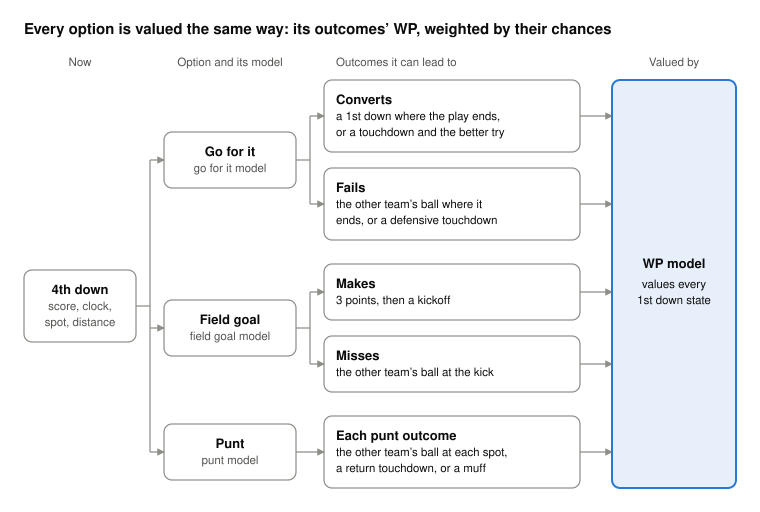

```{r, include = FALSE}
knitr::opts_chunk$set(
  collapse = TRUE,
  comment = "#>",
  echo = FALSE,
  message = FALSE,
  warning = FALSE,
  fig.width = 9,
  fig.height = 5,
  # see 4th-down-research.Rmd: modest dpi keeps the gh-pages branch small
  dpi = 96,
  fig.retina = 2
)
```

```{r setup}
library(nfl4th)
library(ggplot2)

pct <- function(x) sprintf("%.1f%%", 100 * x)

# categorical colors, in a fixed order
col_1 <- "#2a78d6"
col_2 <- "#eb6834"

theme_article <- theme_minimal(base_size = 13) +
  theme(
    panel.grid.minor = element_blank(),
    legend.position = "top",
    legend.justification = "left",
    legend.title = element_blank(),
    plot.title = element_text(face = "bold"),
    plot.title.position = "plot",
    plot.caption = element_text(color = "#52514e", hjust = 0),
    plot.caption.position = "plot"
  )
```

## The short version

On every 4th down, nfl4th estimates the offense's win probability (WP) if it goes for it, kicks a field goal, or punts, and recommends the option with the highest. This page explains how each of those numbers is built. It replaces the [2020 article in The Athletic](https://www.nytimes.com/athletic/2144214/2020/10/28/nfl-fourth-down-decisions-the-math-behind-the-leagues-new-aggressiveness/) that introduced the 4th down bot: every model it describes has since been rebuilt.

The idea hasn't changed. Each option leads to a handful of possible outcomes: a conversion, a failed attempt, a made or missed kick, a punt that lands somewhere. Each outcome is a new game state, and a win probability model says how often teams win from that state. The value of an option is the WP of its outcomes, weighted by how likely each one is.

- **`go_boost`** is the WP of going for it minus the WP of the better kick, in percentage points. Positive means go.
- **The models** that supply the outcome probabilities are fit on public nflverse play-by-play: the WP model on every 1st down since 1999, the go for it model on 3rd and 4th downs since 2001, and the kicking models on recent seasons.
- **The bootstrap** refits the two models that drive most calls on 100 resampled histories and reports how often the call holds. It answers "how sure is the model?", which a single WP number can't.

## Win probability

Every state that follows a 4th down decision is a 1st down: the offense's after a conversion, the other team's after a turnover on downs, a punt or a missed field goal, and the receiving team's after the kickoff that follows a score. So nfl4th's WP model is trained only on 1st downs: every regulation 1st & 10 and 1st & goal since 1999, 416,372 snaps from 7,393 games. Games that went to overtime are included, since a tie at the end of regulation is a real state. Ties are dropped.

**What it uses**, all from the offense's point of view:

- score differential
- time left in the game and in the half
- field position (yards to the end zone)
- both teams' timeouts
- the point spread
- whether the offense is the home team
- in the 1st half, whether the offense receives the 2nd half kickoff

It doesn't use the over/under, weather, the roof, or anything about the teams beyond the spread. The spread is its only measure of how good the two teams are.

**How it's built.** The model follows the recipe of nflfastR's `vegas_wp` model, retuned for 1st downs.

1. **A baseline from the final margin.** A probit model treats the final margin as the current score plus the spread's share of the time left, plus noise that shrinks as the clock runs, as in Hal Stern's 1994 model of the progress of sports scores. This is where most of the WP comes from early in a game. At the end of a half, possessing the ball is worth only the field goals still in play, so the possession terms fade toward the value of a field goal from the current spot.
2. **Tree corrections.** xgboost trees are trained on top of the baseline. They are constrained so that more points, a better spread, being closer to the end zone and having more timeouts never lower WP, and the opponent having more timeouts never raises it.
3. **More trees late.** Early in a game the labels are noisy, so few trees are used (100); in the last minutes the score and clock interact sharply, so many are (1,500). The count changes smoothly with the clock, so WP doesn't jump from one second to the next.

**Rules on top of the model.** A model fit to data can still say impossible things, so a few rules apply:

- **Touchdown cap:** with more than 5 minutes left, WP can't be higher than the WP after scoring a touchdown and kicking the PAT on this snap.
- **Field goal floor:** WP can't be lower than the value of kicking a field goal on this snap.
- **Kneeling out the clock:** a team ahead that can kneel out the clock wins. The kneel time counts 3 seconds per kneel plus 40 seconds between kneels that the trailing team can't stop with a timeout or the 2 minute warning. WP moves back toward the model 10 to 40 seconds short of that.
- **Behind late:** a team behind deep in its own half moves to WP 0 over the last 20 seconds.
- **Tied at the end:** WP moves over the last 10 seconds to the value of the best option left at 0:00, a field goal from this spot or overtime.
- **Smoothing:** in the last 4 minutes WP is averaged over 16 seconds and 2 yards either side, which removes the trees' steps between consecutive seconds and yard lines.

**Overtime** states are valued with nflfastR's overtime model, plus the overtime rules in force that season: sudden death, the modified rule where a first-possession field goal lets the other team answer, and the current rule where both teams get the ball (postseason since 2022, regular season since 2025). A regular-season overtime that runs out ends tied and is worth half a win.

**How good is it?** On 2022–2026 1st downs (70,262 snaps), which none of these models were trained on, the new model scores better than what nfl4th used before and better than nflfastR's new `vegas_wp` model trained on the same seasons.

| Model | Log Loss | Brier Score | Calibration Error (WP Points) |
|---|---|---|---|
| nfl4th Before (Old Model Averaged With nflfastR's Old `vegas_wp`) | 0.46511 | 0.15397 | 1.37 |
| nfl4th's Old Model Alone | 0.46599 | 0.15426 | 1.45 |
| nflfastR's New `vegas_wp` (All Downs, Through 2021) | 0.46457 | 0.15406 | 1.25 |
| **nfl4th's New Model (Through 2021)** | **0.46390** | **0.15386** | **1.22** |

The old models are as shipped: nfl4th's was trained on 2001–2021 and nflfastR's through 2020. Against what nfl4th returned before, the log loss gain is small (−0.0012, 95% CI −0.0026 to +0.0003). Against nfl4th's old model alone it is −0.0021 (CI −0.0037 to −0.0005).

The bigger change is in the model's shape. On a grid of tied states in the first three quarters, nfl4th's old WP valued 1st & goal at the 2 more than half a point above the touchdown itself 25% of the time, by up to 5.6 points. Its WP also wobbled from one second and one yard line to the next. The new model never values 1st & goal above the touchdown, and it is about 5 times smoother along the field and 20 times smoother along the clock.

<!-- TODO figure: calibration of the WP model on 2022-2026 1st downs, by quarter (fit through 2021). Needs the holdout
predictions saved from nfl4th-checks/wp_root/work/14_holdout.R as a small summary table. -->

## Going for it

The go for it model gives the full distribution of where a 4th down attempt ends, not just the chance of converting. It is fit on every 3rd and 4th down attempt since 2001 (200,544 plays, 14,835 of them on 4th down) and has four smooth parts:

1. **Conversion:** a logistic generalized additive model (GAM).
2. **Touchdown given a conversion,** by the room between the line to gain and the end zone, and the distance.
3. **Where a conversion that doesn't score ends,** in yards past the line to gain.
4. **Where a failed attempt ends,** at most 10 yards behind the line and never behind the offense's own 1.

The value of going is the WP of every one of those spots, weighted by its probability. A long touchdown is valued as a touchdown, not folded into an average gain.

**What the conversion model uses:**

- **Distance and field position**, and how they interact. Goal to go has its own field position curve, and every 4th & goal conversion is a touchdown.
- **The down.** 4th downs convert differently from 3rd downs at the same distance, with their own distance curve. 3rd downs stay in because they make the 4th down predictions better (fit on 4th downs alone, out of sample log loss on 4th downs is worse).
- **The spread and the total.** A favorite converts more often. The spread matters less on 4th and long: about 0.017 on the logit per point of spread at 4th & 1 and 0.008 at 4th & 10.
- **Era.** Since 2020, 4th downs convert more often at short and medium distances and slightly less at long ones, so the 2020+ shift depends on distance. Future seasons use the latest era.
- **Late and desperate situations** (below).

**Late and desperate.** A play is late in the last 10 minutes of the 4th quarter or overtime while the offense trails, or when nfl4th's WP is below 15%. Late attempts convert more often at long distances: 36% against 28% at 4th & 8–10 since 2001. Most 4th and long attempts are late (599 of 664 at 4th & 8–10 since 2015), so a model with one curve would predict ordinary 4th and long at the late rate and tell teams to go too often. Late plays get their own conversion curve. The last 2 minutes of the 1st half aren't late: those 4th downs convert like ordinary ones or worse.

**What counts as an attempt:**

- **In:** runs, passes and sacks; interceptions and lost fumbles, as failures; defensive penalties that give a first down, including ones where no play is run (offside).
- **Out:** encroachment and neutral zone infractions (the offense may only have been trying to draw the defense offside), offensive fouls before the snap (the down is replayed), fake punts and field goals, kneels and spikes.

**Defensive touchdowns.** The yards distribution puts a pick six where the defense takes over. A separate model gives the chance that a failed attempt is returned for a touchdown: a logistic GAM on every failed 3rd and 4th down since 2001 (670 defensive touchdowns). It's 0.3% to 2.8% of failed 4th downs today, highest when the offense is near its own goal line, since the return is shorter. That share of failures is valued as the defense scoring, taking the better try and kicking off.

**How good is it?** Fit through 2019 and tested on 2020–2026 4th downs (5,156 plays), conversion log loss is 0.6417, against 0.6453 for the previous model. In sample over 2015–2026, predicted conversion is within 1.7 standard errors of actual at every distance in both eras, and within 1.4 for ordinary and late plays separately.

```{r fig-conversion, fig.height = 5.5, fig.alt = "4th down conversion rate by distance, actual and predicted, for ordinary and late plays, 2015-2026"}
# 4th down attempts 2015-2026, as labeled in training (data-raw/_go_for_it_model.R, fd_model_data()), with the
# shipped model's predictions (in sample). From the calibration check in nflverse/nfl4th#64.
calib <- data.frame(
  situation = rep(c("Ordinary", "Late and desperate"), each = 7),
  distance = rep(c("1", "2", "3", "4–5", "6–7", "8–10", "11+"), 2),
  plays = c(2218, 595, 370, 333, 135, 56, 34, 861, 471, 349, 698, 402, 600, 569),
  actual = c(68.6, 61.5, 52.7, 50.2, 40.7, 23.2, 14.7, 65.7, 57.1, 52.4, 52.1, 44.0, 34.5, 24.4),
  predicted = c(69.8, 59.1, 54.1, 48.0, 38.9, 30.6, 17.6, 64.2, 56.4, 54.0, 49.5, 43.2, 36.7, 22.9)
)
calib$distance <- factor(calib$distance, levels = unique(calib$distance))
calib$situation <- factor(calib$situation, levels = c("Ordinary", "Late and desperate"))
calib$se <- 100 * sqrt(calib$actual / 100 * (1 - calib$actual / 100) / calib$plays)

ggplot(calib, aes(x = distance)) +
  geom_linerange(
    aes(ymin = actual - 2 * se, ymax = actual + 2 * se, color = "Actual (± 2 SE)"),
    linewidth = 0.8
  ) +
  geom_point(aes(y = actual, color = "Actual (± 2 SE)"), size = 2.5) +
  geom_line(aes(y = predicted, group = 1, color = "Predicted"), linewidth = 1) +
  geom_point(aes(y = predicted, color = "Predicted"), size = 2.5, shape = 18) +
  facet_wrap(~situation) +
  scale_color_manual(values = c("Actual (± 2 SE)" = "#52514e", "Predicted" = col_1)) +
  scale_y_continuous(labels = function(x) paste0(x, "%"), limits = c(0, 85)) +
  labs(
    title = "Predicted 4th down conversion tracks the actual rate at every distance",
    x = "Yards to go",
    y = "Conversion rate",
    caption = "4th down attempts 2015–2026. Late and desperate: last 10 minutes of the 4th quarter or overtime while trailing, or WP below 15%."
  ) +
  theme_article
```

## Field goals

A field goal has two outcomes. A make is worth 3 points and a kickoff; a miss gives the other team the ball at the spot of the kick, 8 yards behind the line of scrimmage, or at its own 20 if that's better for it.

**The make probability** is a GAM in distance, fit on field goal attempts since 2014, with separate curves for outdoor and indoor stadiums and for 2014–2022 and 2023 on. The kick distance is the line of scrimmage plus 18 yards: 10 yards of end zone and the hold 8 yards back.

**Long kicks need a correction.** Only teams that trust their kicker try very long field goals, so the make rate past about 52 yards describes good kickers, not the average one. At 57 yards only about 9% of teams facing 4th & 5 or longer try one. So nfl4th measures how often teams attempt a kick at each distance and, where few do, leans on the curve fit at distances where nearly everyone kicks. The correction can only lower the make probability.

Past 62 yards there are too few attempts to fit. The make probability continues along the curve and fades to zero between 65 and 75 yards. Since 2023, kicks of 64 yards or more have gone 7 for 19.

```{r fig-fg, fig.alt = "Field goal make probability by kick distance, outdoors and indoors, 2023 on"}
fg <- nfl4th:::fg_prob_df
fg <- fg[fg$fg_model_roof %in% c("01", "11"), ]
fg$distance <- fg$yardline_100 + 18
fg$roof <- factor(ifelse(fg$fg_model_roof == "11", "Outdoors", "Indoors"), levels = c("Outdoors", "Indoors"))

ggplot(fg, aes(distance, 100 * fg_make_prob, color = roof)) +
  annotate("rect", xmin = 62, xmax = 75, ymin = -Inf, ymax = Inf, fill = "#f0efec") +
  annotate(
    "text", x = 62.5, y = 95, hjust = 0, size = 3.5, color = "#52514e",
    label = "Too few kicks to fit:\nthe curve continues,\nthen fades to 0"
  ) +
  geom_hline(yintercept = 0, color = "black", linewidth = 0.8) +
  geom_line(linewidth = 1) +
  scale_color_manual(values = c("Outdoors" = col_1, "Indoors" = col_2)) +
  scale_x_continuous(breaks = seq(20, 75, 5), limits = c(18, 75)) +
  scale_y_continuous(labels = function(x) paste0(x, "%"), limits = c(0, 100)) +
  labs(
    title = "Field goal make probability, 2023 on",
    x = "Kick distance (yards)",
    y = "Make probability"
  ) +
  theme_article
```

**Compared with before.** Up to 63 yards the table is the same as the one nfl4th used before: log loss on every attempt since 2014 is 0.3647 for both. The change is past 63 yards, where the old table fell to zero at 72 yards. Since 2023, kicks of 64 yards or more went 7 for 19 (37%). The old table gave those kicks 27% on average, the new one 30%.

At 55–59 yards both tables are about 4 points below the make rate of the kicks teams actually tried (61% predicted, 66% made since 2023). That is the long kick correction working as intended: the table describes the average kicker, not the ones trusted to try.

**After a kickoff,** the receiving team's first snap is at the average start for that era's kickoff rules: its own 22 (2011–2015), 25 (2016–2023), 30 (2024) or 31 (2025 on).

## Punts

The punt model gives, for every line of scrimmage from the opponent's 31 back to the punting team's own 1, the probability of each outcome: where the receiving team's first snap is (touchbacks included), a return touchdown, or a muff the punting team recovers. The value of punting is the WP of each outcome, weighted by its probability.

It has three smooth parts, fit on the punts of the last 8 seasons (16,217 since 2019). Net punts have gained about 3 yards since 2010–2013, so older seasons would undervalue punting today.

1. **Where the receiving team's first snap is:** a smooth model of its yard line that changes smoothly with the line of scrimmage, with its own term for touchbacks at the 20. It uses the next snap rather than the kick and return yards, so blocked punts and penalties on the return are in it.
2. **A return touchdown,** including blocked punts returned for a touchdown, by line of scrimmage.
3. **A muff the punting team recovers,** by line of scrimmage. The punting team gets the ball at the receiving team's average start.

| Punting From | Touchback | Start Inside the 10 | Return TD | Muff Recovered | Average Start |
|---|---|---|---|---|---|
| Opponent's 40 | 19% | 54% | 0.1% | 0.6% | Own 11 |
| Midfield | 15% | 39% | 0.2% | 0.9% | Own 13 |
| Own 40 | 15% | 20% | 0.3% | 1.2% | Own 18 |
| Own 30 | 6% | 6% | 0.5% | 1.3% | Own 25 |
| Own 20 | 1% | 1% | 0.8% | 1.3% | Own 36 |
| Own 5 | 0% | 0% | 1.3% | 1.1% | Midfield |

The average start counts touchbacks at the 20 and leaves out return touchdowns and muffs.

Nothing in the punt model depends on the teams, the weather or the score. A punt from inside the opponent's 31 isn't valued.

**Compared with before.** The previous punt model was built from 2010–2019 punts. To compare them fairly, the new recipe was refit on 2018–2025 and both were tested on 2026 punts (1,028), which neither had seen:

| Measure | Old Model (2010–2019) | New Recipe (2018–2025) | Actual 2026 |
|---|---|---|---|
| Receiving Team's Average Start | Own 25.3 | Own 24.5 | Own 23.6 |
| Start at the 20 (Mostly Touchbacks), Punting From the Opponent's 31 to Midfield | 4.9% | 16.2% | 16.9% |
| 2026 Punts Given Zero Chance | 2 | 0 | — |
| Log Loss (Start in 5 Yard Bins, Return TD or Muff) | 1.947 | **1.872** | — |

The log loss gain is 0.075 per punt (SE 0.012), on the 1,026 punts both models give a chance. Both expect the receiving team to start a little further up the field than it has in 2026: punting keeps getting better.

## The try after a touchdown

After a touchdown, nfl4th values both tries and takes the better one, for the scoring team. Each try is followed by a kickoff. `add_2pt_probs()` returns the same comparison as a recommendation.

- **Going for 2** is a 4th and goal from the 2, so its conversion probability comes from the go for it model, with the game's spread and total. 2 point tries convert about as often in every era (48.1% in 2001–2019, 49.1% since 2020), so every season uses the model's latest era. The go for it model never sees a 2 point try, but on 2,125 tries from the 2 since 2001 it predicts 48.9% against 48.5% actual. The spread moves a try from 45.6% for a 10 point underdog to 52.8% for a 10 point favorite.
- **The PAT** uses the field goal model at the 15: 94.9% outdoors and 95.2% indoors since 2023.

**Compared with before.** The old model was a separate xgboost model fit on about 800 tries from 2010–2019. On 2020–2026 tries (768), which it never saw, log loss is 0.6916 with the go for it model, 0.6955 with the old model, and 0.6932 for simply predicting the 2001–2019 average. The old model did worse than that average. A model of the try in the point spread alone didn't hold up either, because the point spread mattered much less after 2019 than before.

## The clock

Late in a half, how much time each option uses can matter as much as where the ball ends up.

- **Punts, field goals, failed attempts and touchdowns** stop the clock with a change of possession, so the next state comes 6 seconds after the snap.
- **A conversion that doesn't score keeps the clock running.** It is valued at the offense's next snap: the average gap after 3rd and 4th down conversions in 2016–2026, by quarter, time left in the half and score.

| Situation | Seconds to the Next Snap |
|---|---|
| 1st and 3rd Quarters, or More Than 5:00 Left in a Half | About 37 |
| 4th Quarter, Behind or Tied: 2:00–5:00 / 1:00–2:00 / 0:30–1:00 / Last 0:30 | 25 / 19 / 15 / 10 |
| 2nd Quarter: 1:00–2:00 / 0:30–1:00 / Last 0:30 | 20 / 13 / 7 |
| 4th Quarter, Ahead: 2:00–5:00 / Inside 2:00 | 27 / 35 |

**In the last 2 minutes of a half,** timeouts change this:

- **A team with a timeout** can stop the clock right after the play, so each conversion is also valued with only the play's own time run off (6 seconds plus 0.1 per yard gained) and a timeout spent. The team takes the better of the two.
- **A team without one** often can't get another snap off. After conversions in the last 7 seconds the clock ran out first 84% of the time, 65% at 7–10 seconds and 44% at 10–15. Those conversions are valued as that mix.
- **0:00 ends the game.** A conversion that runs out the clock at the end of regulation is the final result: the team ahead wins and a tie goes to overtime. At the end of the 1st half it becomes the 2nd half kickoff.

`add_4th_probs()` takes a `runoff` column for anyone who wants to set the time between the conversion and the next snap themselves.

## Putting it together

For each 4th down, nfl4th builds every state each option can lead to, runs the clock, values each state with the WP model, and averages by the outcome probabilities. The option with the highest WP is the recommendation.

```{r fig-tree, out.width = "100%", fig.alt = "Diagram: a 4th down leads to three options (go for it, field goal, punt), each with its own outcomes, and the same WP model values every outcome"}

```

The options differ only in their outcomes and the model that gives their chances. The same WP model values every state they lead to.

**What each model uses:**

| Input | Win Probability | Going for It | Field Goal | Punt |
|---|---|---|---|---|
| Score, Clock, Timeouts | Yes | Through the Late Flag | — | — |
| Field Position | Yes | Yes | Yes (Kick Distance) | Yes |
| Yards to Go | Always a 1st Down | Yes | — | — |
| Point Spread | Yes | Yes | — | — |
| Over/Under | — | Yes | — | — |
| Home Team | Yes | — | — | — |
| Receiving the 2nd Half Kickoff | Yes | — | — | — |
| Roof | — | — | Outdoors or Not | — |
| Era | — | 4th Downs: 2001–2019, 2020 On | 2014–2022, 2023 On | Last 8 Seasons Only |

**An example.** Week 5 of 2026, Buffalo at the Rams, 5:40 left in the 1st quarter. The Rams are 3.5 point favorites, trail by 3, and face 4th & 5 at the Buffalo 32. They tried a 50 yard field goal and missed. nfl4th looks up the spread, the total and the roof from the game:

```{r example, echo = TRUE}
one_play <- tibble::tibble(
  home_team = "LA",
  away_team = "BUF",
  posteam = "LA",
  type = "reg",
  season = 2026,
  qtr = 1,
  quarter_seconds_remaining = 340,
  ydstogo = 5,
  yardline_100 = 32,
  score_differential = -3,
  home_opening_kickoff = 0,
  posteam_timeouts_remaining = 3,
  defteam_timeouts_remaining = 3
)

probs <- add_4th_probs(one_play)
```

| Option | What Can Happen | Rams' WP |
|---|---|---|
| Go for It | Converts `r pct(probs$first_down_prob)` of the time (WP `r pct(probs$wp_succeed)` after, averaged over where the play ends); fails `r pct(1 - probs$first_down_prob)` (WP `r pct(probs$wp_fail)`) | **`r pct(probs$go_wp)`** |
| Field Goal | A 50 yard try: made `r pct(probs$fg_make_prob)` of the time (WP `r pct(probs$make_fg_wp)`); missed, Buffalo's ball at its 40 (WP `r pct(probs$miss_fg_wp)`) | `r pct(probs$fg_wp)` |
| Punt | Buffalo's ball deep in its own end: a touchback or a start inside its 20, by the punt model | `r pct(probs$punt_wp)` |

Going for it is worth `r sprintf("%.1f", probs$go_boost)` WP points more than the field goal, so `go_boost` is +`r sprintf("%.1f", probs$go_boost)`: a lean, not a clear call. In the bootstrap (next section), 82 of the 101 fits agree that going is best, and the 80% interval on `go_boost` is −0.3 to +1.5.

## How sure is the model? The bootstrap

The models are fit on a finite history, so a different history would give slightly different models and sometimes a different call. `add_4th_probs(bootstrap = TRUE)` measures that. It refits nfl4th's two main models on 100 resampled histories and values every play under each one. On 2026 weeks 1–9, 83% of go recommendations held in at least 83% of the refits, and all the uncertain ones were within a point of a toss-up.

**What is refit.** Each draw resamples whole games with replacement, as many as there are, and refits the WP model and the go for it model on the same games. The go for it fit builds its late flag with that draw's WP model. The punt, field goal and defensive touchdown models and nflfastR's overtime model are the same in every draw: their sampling error is small next to the two models that drive the calls. With the shipped fit, that makes 101 draws.

**Why whole games.** Every snap of a game shares one label, who won, so the snaps of a game aren't independent. Resampling snaps one at a time would act as if there were far more information than there is. The game is the unit.

**Why all the games (φ = 1) and not half.** In [*Analytics, have some humility*](https://arxiv.org/abs/2311.03490), Brill, Yurko and Wyner argue that 4th down recommendations should come with this kind of uncertainty, and nfl4th's bootstrap follows their approach. They draw half the games in each refit (a fractional bootstrap, φ = 0.5). They chose 0.5 in a simulated toy game, where the plain bootstrap was too narrow, partly because a bootstrap can't see a model's bias. Drawing half the games widens the intervals to make up for that, by an amount specific to that simulation and that model.

We checked φ directly on nfl4th's models and real games. The question is how much a play's `go_boost` changes only because the models were trained on a different set of games. Call that the noise.

1. **Measure the noise directly.** Split the games at random into two halves and train both models on each half. The halves share no games, so the two sets of models differ only because they saw different games. On every 2026 4th down (weeks 1–9), the gap between their two `go_boost`s is pure noise. We did this for 10 different splits.
2. **Ask the bootstrap.** Take one half, resample its games and retrain many times, with φ = 1 (as many games as the half has) and with φ = 0.5 (half as many). How much `go_boost` moves across those refits is the bootstrap's estimate of the same noise.
3. **Compare.** If the bootstrap is right, its estimate matches the measured noise. We compare on `go_boost` and on field goal minus punt, since every decision is a comparison between options.

| Measured Noise ÷ Bootstrap's Estimate (Variance; 1 Is Right) | φ = 1 | φ = 0.5 |
|---|---|---|
| `go_boost` | **0.88** (SE 0.04); 80% intervals held 82% of the time | 0.54 (SE 0.02); 90% intervals held 97% |
| Field Goal − Punt | **0.97** (SE 0.07) | 0.60 (SE 0.04) |
| WP of a Single Option | 1.02–1.08 | 0.58–0.59 |

With φ = 1 the bootstrap gets the noise about right, slightly high. With φ = 0.5 it says the noise is about 1.8 times bigger than it really is, so its intervals are too wide.

This isn't circular. The measured noise involves no resampling: it is the gap between two models trained on different games. The bootstrap sees only one half, so it has to guess that gap from one set of games, by assuming that resampling your own games behaves like getting new ones. That assumption can fail, and the check can catch it: φ = 0.5 fails it, and in the paper's simulation the plain bootstrap failed in the other direction.

**The gap between options is less uncertain than either option.** Every option is valued with the same WP model at states of the same game, so most of the WP model's error is shared: the half fits' errors correlate 0.86–0.91 across options. Shared error cancels in a comparison. The standard deviation is 1.55 WP points for one option's WP, but 0.82 for going minus a field goal.

**Why these intervals are narrower than the paper's.** Their highlighted example is a 1.1 point edge with an interval of about −4 to +5.

- **More data in every refit.** nfl4th's models use 1999–2026 (the go for it model 2001–2026), 7,409 games, and each refit draws all of them. The paper's use 2006–2021, 4,101 games, and each refit draws about 2,050. That's about 3.6 times as many games, which alone makes the noise about 1.9 times smaller.
- **φ = 1,** as above.
- **Both models on the same games.** The paper also resamples drives within games, and fits its conversion, punt and field goal models on plays resampled one at a time.

**What you get:**

- `boot_pct`: the share of draws whose best option is the shipped fit's.
- `boot_go_pct`: the share of draws in which going beats the better kick.
- `go_boost_lo` and `go_boost_hi`: the 10th and 90th percentiles of `go_boost`, an 80% interval.
- `boot_median_draw`: the draw with the median `go_boost`, for one coherent set of numbers at the median.
- each draw's `go_boost` and every probability `add_4th_probs()` returns, as list columns.

**How wide are the intervals?** All 2,068 regulation 4th downs of 2026 weeks 1–9: going is recommended on 995 (positive `go_boost`) and kicking on 1,073. Confident means at least 83% of draws agree on go vs kick, and uncertain under 67%, the paper's tiers.

| `go_boost` | Plays | Median `go_boost` | Median Width of the 80% Interval | Interval on the Recommended Side | Teams Went |
|---|---|---|---|---|---|
| −5 or Less | 99 | −6.18 | 1.6 | 100% | 0% |
| −5 to −3 | 199 | −3.80 | 1.3 | 100% | 0% |
| −3 to −2 | 176 | −2.48 | 1.4 | 99% | 1% |
| −2 to −1 | 224 | −1.43 | 1.2 | 95% | 3% |
| −1 to 1 | 798 | 0.01 | 1.0 | | 15% |
| 1 to 2 | 202 | 1.52 | 1.5 | 97% | 31% |
| 2 to 3 | 157 | 2.39 | 1.7 | 99% | 42% |
| 3 to 5 | 145 | 3.76 | 1.9 | 99% | 67% |
| 5 or More | 68 | 6.22 | 3.1 | 100% | 72% |

The typical go recommendation (`go_boost` +1.4) has an 80% interval about 1.5 WP points wide. 4th & 7–10 is where calls are thinnest: median `go_boost` +0.38, and 33% of those go calls are uncertain. Kick calls look the same as go calls: once a call is more than a point from a toss-up, the draws almost never disagree. Teams went for it on 19% of these plays. They almost never go when the model says kick, but even on calls that are clear in every draw (go by 1 to 3 points) they go only about a third of the time.

**What the intervals leave out.** They measure sampling uncertainty only: how much the fit would move with a different history. Bias that every fit of the same recipe shares isn't in them, and neither is anything the models don't see. The known example is late 4th & 8–10, where predicted conversion runs about 3.5 points high out of sample (see the limitations below).

## What the models don't know

- **Late 4th and long.** Since 2020, late 4th & 8–10 attempts are predicted to convert about 3.5 points more often than they did out of sample (36.5% vs 32.9%; z −1.5). In a related cut, when trailing on 4th & 4+ and the model says go by 1–3 points, teams that went did 4.5 points worse than predicted relative to teams that kicked (SE 2.7). This is the place to be most careful with a go call.
- **The teams.** Beyond the spread, nothing about the two teams is used: not the kicker, the punter, the offense's short-yardage strength, injuries or the weather.
- **Eras move only with a retrain.** If a rule change shifts conversion or kicking rates, the models won't see it until they are rebuilt with a new era.
- **Punting** is fit on the last 8 seasons with no era term, so older seasons are valued with today's punting.
- **The clock after a conversion** is the average gap to the next snap, or the play's own time when a team stops the clock. Real plays vary by a few seconds, which matters only in the last seconds of a half.
- **Hard counts.** Encroachment and neutral zone infractions are left out of the conversion data, so the value of trying to draw the defense offside isn't priced.
- **End of the 1st half.** In the last 30 seconds, WP for a team at its own 11–29 is about 2 points too low.
- **Overtime timeouts** aren't used, as in nflfastR's overtime model.

**Checked against results.** Every regulation 4th down from 2016–2025 was scored, and each team's result compared with the model's WP for the option it chose. Where the model said go by at least a point, teams that went did about as well as predicted relative to teams that kicked: 0.3 points worse late in games (SE 1.3) and 0.1 points worse otherwise (SE 1.1).

## Using it

- **`add_4th_probs()`** values 4th downs in nflfastR play-by-play or hand-built plays and returns the WP of each option, the outcome probabilities and `go_boost`. A play takes about 0.1 seconds.
- **`add_4th_probs(bootstrap = TRUE)`** adds the bootstrap columns. The 101 draws (38 MB) download once and are cached. A play takes 0.3–0.85 seconds, or 0.2–0.4 with `nfl4th_start_workers()`, which spreads the draws over worker processes.
- **`add_2pt_probs()`** does the same for the try after a touchdown.
- **`load_4th_pbp()`** returns every 4th down of a season with the probabilities already added.

The models are built by the scripts in `data-raw/` of the [nfl4th repository](https://github.com/nflverse/nfl4th), most in a few minutes from public nflverse play-by-play. The [getting started article](nfl4th.html) has examples, and [4th down research](4th-down-research.html) collects work on 4th down decisions.

**References**

- Brill, Yurko and Wyner (2023), [*Analytics, have some humility: a statistical view of fourth-down decision making*](https://arxiv.org/abs/2311.03490).
- Stern (1994), "A Brownian motion model for the progress of sports scores," *Journal of the American Statistical Association* 89(427).
- [nflfastR](https://www.nflfastr.com/), whose `vegas_wp` recipe the WP model follows and whose overtime model nfl4th uses.
